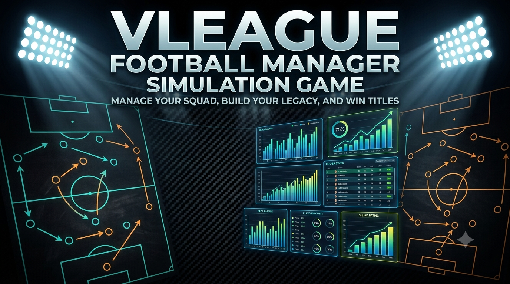

  

   
   

  
  
  -red?style=for-the-badge)

---

# Touchline

A high-performance desktop simulation game where you step into the shoes of a football club manager. Build your squad, master the transfer market, outmaneuver rivals with custom tactical strategies, and forge your legacy as a champion.

---

## 🌟 Overview

Whether you are building a squad from scratch or taking over a powerhouse club, **Touchline** provides a deep, data-driven football management experience. Driven by sophisticated statistical and mathematical models, every match result, player growth curve, and transfer negotiation reflects realistic sports dynamics.

---

## ✨ Key Features

* **Squad Building & Management**
  * Assemble your dream team from a rich database of players.
  * Develop youth prospects, balance player morale, and manage squad fatigue over long seasons.

* **Transfer Window Dynamics**
  * Scout global talent and uncover hidden gems.
  * Negotiate contracts, handle agent demands, and outbid competitor clubs during intense transfer windows.

* **Tactical Depth & Match Simulation**
  * Set up formations, player roles, and match strategies tailored to your opponent.
  * Experience realistic match simulations where statistical edge meets dynamic game-day events.

* **League & Tournament Progression**
  * Compete in multi-tier league structures and knockout cup competitions.
  * Track season-by-season statistics, trophies won, and manager reputation over a long-term career.

* **Build Your Legacy**
  * Earn board confidence and fan support through consistent results.
  * Cement your position among management legends across decades of simulated seasons.

---

## 🎮 Getting Started

> **Note:** *This project is currently in the initial planning and design phase. Features and interface layouts are subject to evolution as development progresses.*

### Prerequisites

* A compatible desktop operating system (**Windows**, **macOS**, or **Linux**).

### Running the Application

Detailed installation instructions, pre-built installers, and setup guides will be provided here once initial releases become available.

---

## 🗺️ Roadmap & Future Vision

* **Phase 1: Core Engine & Basic Simulation** *(Current)*
  * Establishing core statistical match engine and basic club management features.

* **Phase 2: Expanded Management**
  * In-depth scouting networks, youth academies, and dynamic board expectations.

* **Phase 3: Visual & UI Enhancements**
  * Richer match visualizations, statistical dashboards, and historical record books.

---

## 📄 License

This project is licensed under a custom end-user agreement — see the [LICENSE](LICENSE) file for details.  
Copyright (c) 2026 Syed Vilayat Ali Rizvi.